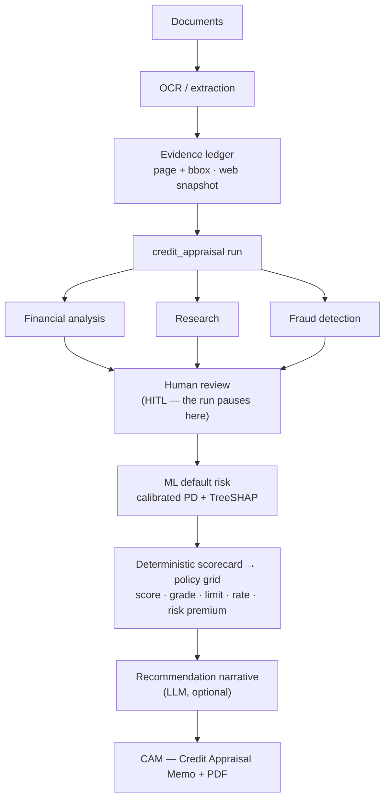

<div align="center">

# 🏦 IntelliCredit AI

**An explainable AI platform for corporate credit intelligence.**

[](https://www.python.org/)
[](https://fastapi.tiangolo.com/)
[](https://langchain-ai.github.io/langgraph/)
[](https://ai.google.dev/)
[](https://www.postgresql.org/)
[](https://redis.io/)
[](https://xgboost.ai/)
[](https://nextjs.org/)
[](https://www.docker.com/)

It turns a pile of heterogeneous company evidence — GST returns, ITRs, bank statements, annual reports, contracts, legal notices — into a **citation-backed, quantitatively auditable credit decision** that a human can inspect, challenge, and sign off on.

</div>

The one idea to remember: **the language model does not decide credit.** It reads
documents, researches the web, and writes prose. Every *number* — the score, the
grade, the sanctioned limit, the interest rate, the probability of default — is
produced by deterministic code and a calibrated ML model, and every claim in the
final memo links back to the exact page (and bounding box) or web snapshot it
came from.



> The human review gate sits **before** ML and scoring on purpose: the credit
> officer's qualitative note is folded into the score, and the before/after delta
> is recorded in the trace. The number reacts to the human, auditably.

---

## Table of contents

1. [The core differentiator — the LLM does not decide credit](#1--the-core-differentiator)
2. [Structural explainability — Evidence → Claim → Score → Decision](#2--structural-explainability)
3. [Architecture](#3--architecture)
4. [Why not just use an LLM?](#4--why-not-just-use-an-llm)
5. [One engine, twelve workflows — the extensibility mechanism](#5--one-engine-twelve-workflows)
6. [What's real vs. prototype](#6--whats-real-vs-prototype)
7. [Quickstart](#7--quickstart)
8. [Verified status](#8--verified-status)
9. [Documentation index](#9--documentation-index)

---

## 1 · The core differentiator

Most "AI credit" demos ask a large language model to read some documents and
emit a rating. That is exactly the thing a regulated lender can never ship: an
LLM will, when pushed, **hallucinate a plausible number** — a credit score, a
loan limit, an interest rate — with total confidence and no derivation.

IntelliCredit is built the other way around. Responsibilities are split by what
each component is actually good at:

```text
   LLM
     → extracts fields from documents, researches the web, writes narrative
       (always with citations; never a final number)

   Deterministic code + calibrated ML
     → computes the quantitative risk (financial ratios, calibrated PD, SHAP)

   Policy engine (scorecard + policy grid)
     → determines the decision, the limit, the price — as printable arithmetic

   Human (credit officer)
     → reviews qualitative context, adds notes, can force outcomes; the run
       pauses for them and re-scores with their input
```

This is enforced in code, not merely intended:

- The scorecard consumes only typed numeric inputs; the LLM's role upstream is to
  classify unstructured text into *enumerated levels* (with citations), which the
  deterministic normalizer then scores — `backend/app/analysis/scorecard.py`.
- The CAM generator **re-derives every number deterministically** and the
  narrative prompt is explicitly told the figures are fixed ("do NOT change any
  number") — `backend/app/agents/credit.py`.
- The report renderer **schema-refuses uncited factual claims**, and a numeric
  post-validator rejects any narrative number absent from the machine-readable
  explanation bundle — [ADR-0011](docs/adr/ADR-0011-report-ir-and-renderers.md).

**A language model cannot invent a loan limit, an interest rate, or a credit
score in this system.** That property is the product.

---

## 2 · Structural explainability

Explainability here is *structural*, not a prompt asking the model to "explain
your reasoning." Every result is a link in a chain you can walk backwards:

```text
   Annual report (uploaded PDF)
        ↓        document + page + bounding box, stored in the evidence ledger
   Page 42
        ↓        extracted, validated line item
   Revenue = ₹100,000,000
        ↓        deterministic ratio computation
   Financial ratio (e.g. interest coverage 1.4×)
        ↓        piecewise-linear normalizer × pillar weight
   Score contribution (+/− points, printed)
        ↓        scorecard total → grade → policy grid
   Credit decision (grade IC4 · APPROVE · ₹4.2 Cr · 11.75%)
```

Every claim in the evidence ledger carries its provenance:

- **document** id, **page** number, and a normalized **bounding box** (`[0,1]`
  page space) for on-document highlighting;
- the exact **quote** that was cited;
- for web findings, the **source URL** plus a **content-hashed snapshot** taken
  at claim time, so link rot can never break "walk me through it" months later.

In the UI a judge clicks a cited value in the CAM or the evidence panel and the
document viewer opens the rendered page with the region highlighted. The whole
"explain this decision" experience is a **database query over the evidence
ledger**, which is simultaneously the RAG citation store, the agent trace, and
the observability log — one write path, three uses
([ADR-0012](docs/adr/ADR-0012-first-party-tracing.md)).

---

## 3 · Architecture

A **modular monolith**: one FastAPI backend image run three ways (API, Celery
worker, Celery beat), one Next.js frontend, and exactly **two stateful services**
— PostgreSQL 17 (+pgvector) and Redis 7. One `docker compose up` is the whole
platform.

```text
                              IntelliCredit
                                    │
        ┌───────────────────────────┼───────────────────────────┐
        │                           │                           │
    Ingestion                   Research                   Intelligence
        │                           │                           │
   OCR / vision                 web search                  financial ratios
   extraction                   snapshots                   fraud forensics
   (per-page,                   (content-hashed)            calibrated ML + SHAP
   validator-gated)                 │                           │
        └───────────────────────────┼───────────────────────────┘
                                    ▼
                             Evidence ledger
                    (claim · page · bbox · quote · source · confidence)
                                    ▼
                              LangGraph
                       durable workflow engine
                    (checkpointed to Postgres, resumable)
                                    ▼
                          Human-in-the-loop
                       (interrupt / review / resume)
                                    ▼
                    Deterministic scorecard + policy grid
                    (score · grade · limit · rate — pure arithmetic)
                                    ▼
                            Credit decision
                                    ▼
                        CAM (memo · HTML · PDF)
```

PostgreSQL is deliberately the **everything-store**: relational system of record,
vector index (pgvector HNSW), full-text search, LangGraph checkpoints, the
evidence/trace ledger, the ML model registry, and feature flags — one backup,
one migration story, transactional consistency between a chunk, its document, its
evidence rows, and its tenant scope
([ADR-0002](docs/adr/ADR-0002-postgres-as-the-everything-store.md)).

**Stack:** Python 3.13 · FastAPI · SQLAlchemy 2.0 async · Alembic · PostgreSQL 17
+ pgvector · Redis 7 · Celery · **LangGraph** (durable checkpoints, HITL
interrupts) · Gemini 2.5/3.x Flash + Pro via one `LLMGateway` (LIVE / RECORD /
REPLAY) · RapidOCR + Gemini-vision escalation · **XGBoost + isotonic calibration
+ TreeSHAP** · Next.js 15 · React 19 · TypeScript · Tailwind · shadcn/ui ·
Docker Compose.

Full design: [docs/ARCHITECTURE.md](docs/ARCHITECTURE.md) · the decisions and
their rejected alternatives: [docs/ARCHITECTURE_WALKTHROUGH.md](docs/ARCHITECTURE_WALKTHROUGH.md)
and the 16 [ADRs](docs/adr/).

---

## 4 · Why not just use an LLM?

Because the failure mode is unacceptable in credit:

> **A language model should not be able to hallucinate a loan limit, an interest
> rate, or a credit score.**

An LLM-only system has no mechanism that *prevents* it from confidently emitting
a wrong number, and no way to prove after the fact where a number came from.
IntelliCredit composes six layers precisely so that no single one can fabricate a
decision:

| Layer | What it contributes | Failure it prevents |
|---|---|---|
| **LLM** | reads documents, researches, writes prose | (kept away from arithmetic) |
| **Deterministic financial computation** | ratios, five-Cs, limit formulas | invented or inconsistent math |
| **Calibrated ML** | probability of default, honestly calibrated (ECE ≈ 0.003) | over-confident, uncalibrated risk scores |
| **Policy engine** | grade → decision → limit → rate, as printed formulas | prompt-injected or arbitrary limits/rates |
| **Evidence ledger** | every claim linked to page/bbox or web snapshot | unfalsifiable, uncitable assertions |
| **Human review** | qualitative judgment, override, sign-off | full automation of a regulated decision |

The scorecard is deterministic arithmetic (`S = Σ_pillar W_p · Σ_factor w_f ·
n_f(x_f)`), every term persisted with its evidence references. **Prompt injection
cannot move a number**, because no number is set by a prompt
([ADR-0009](docs/adr/ADR-0009-deterministic-scorecard-and-policy-grid.md)).

---

## 5 · One engine, twelve workflows

Credit appraisal is **workflow #1**. The architectural bet is that the *thirteenth*
workflow (a new vertical — vendor risk, ESG, underwriting, portfolio monitoring)
should be a **configuration exercise, not a code fork**
([ADR-0008](docs/adr/ADR-0008-workflow-as-data.md)).

A workflow is authored as **data**: a YAML definition, validated fail-fast into an
immutable, checksummed, numbered version, then compiled to a LangGraph
`StateGraph` by a single `GraphCompiler` (the only code that touches LangGraph's
builder API). A new vertical is intended to ship as:

```text
   Workflow definition   (YAML: nodes, edges, HITL gates, agent budgets, dashboard)
 + Document pack         (which document types the vertical ingests + extracts)
 + Feature/scorecard config  (pillars → factors → normalizers → weights)
 + Policy config         (grade bands → decision → limit → rate)
 + Report template       (the memo it produces)
```

registered against the agent / predicate / document-type / model registries, with
the frontend rendering **server-driven dashboards** from a fixed block vocabulary
so it never forks per workflow.

**Honest status of this claim.** Exactly **one** workflow — `credit_appraisal`
(v3) — is implemented end-to-end. The *mechanism* is real and exercised: the YAML
definition, the fail-fast Pydantic schema, immutable checksummed versioning, the
single `GraphCompiler`, and the agent/predicate/document-type/model registries
all exist and are unit-tested (a `wf_smoke.yaml` fixture drives the
loader+compiler). Today, three of the five config surfaces above (document pack,
scorecard/policy, report template) are **typed configuration in Python**, invoked
directly — not yet lifted into the declarative YAML. The other eleven workflows
(vendor risk, ESG, …) are a **scheduled extensibility path, not shipped code**.
Per the project's own "harvest the abstraction, don't speculate it" rule, the DSL
is deliberately frozen only after three real workflows exist. We describe this as
an extensibility *mechanism*, and do not claim any future workflow is
production-ready.

See [docs/ARCHITECTURE.md §4](docs/ARCHITECTURE.md) and
[ADR-0008](docs/adr/ADR-0008-workflow-as-data.md).

---

## 6 · What's real vs. prototype

The strongest submission is an honest one. Full detail:
[docs/HACKATHON_SUBMISSION.md](docs/HACKATHON_SUBMISSION.md) and
[docs/FINAL_STATUS.md](docs/FINAL_STATUS.md).

**Implemented and verified**

- Config-driven durable workflow orchestration (LangGraph + Postgres checkpoints)
- Document ingestion, OCR escalation chain, per-page extraction with validators
- Evidence ledger with page + bounding-box + web-snapshot provenance
- Deterministic scorecard, ordered overlays, and policy grid (score/grade/limit/rate)
- Calibrated, explainable ML PD model (XGBoost + isotonic + TreeSHAP reason codes)
- Human-in-the-loop pause → officer note → resume → **re-score** (audited delta)
- CAM generation with citations, and **CAM → PDF export**
- Kill-a-worker → restart → checkpoint-resume with **no duplicate work**
- Full Next.js frontend over the real API (dashboard → evidence → ML → HITL → CAM)
- Backend metrics (`/metrics`), tenant isolation (repository scoping + Postgres RLS)

**Prototype / requires further production validation** *(labeled in-product)*

- **PD model trained on foreign public data** (Polish UCI #365) — output is a
  *relative* default-risk signal re-normalized inside the scorecard, **not** an
  absolute Indian PD calibration (no realized Indian default data is obtainable).
- **LLM extraction accuracy** for financial statements / ITR / annual reports is
  **UNMEASURED** (nondeterministic, API-key-gated). Deterministic extraction of
  GST returns + bank statements *is* measured (1.0 with 0 fabrications on a small,
  wide-CI corpus).
- **Web-research recall/precision** is **UNMEASURED** (needs live keys + a
  ground-truth query set); only the agent's safety and honest degradation are tested.
- **Large-scale / concurrent load** is baselined on hot paths (sub-millisecond
  deterministic steps); a full concurrent-workflow load test is provided as a
  script (`scripts/load_test.py`).
- **MCA / e-Courts** live retrieval is CAPTCHA-gated and treated as uploaded
  document types + cached corpora, never a pretend-live integration.

None of these are hidden; each is surfaced in the UI or the reports.

---

## 7 · Quickstart

Prerequisites: Docker Desktop, ~6 GB free RAM. No API keys are required for the
offline demo (LLM/research steps degrade honestly; the seeded runs use an
offline scripted caller). Full guide: [docs/DEMO_SETUP.md](docs/DEMO_SETUP.md).

```bash
cp .env.example .env
docker compose up -d --build     # postgres+pgvector, redis, migrate (one-shot), api, worker, beat, frontend
make seed                        # demo tenant + 3 role users + synthetic companies/cases
```

On Windows, run `make` targets from Git Bash/WSL, or run the underlying
`docker compose ...` commands directly.

- **Frontend** → http://localhost:3000 (login pre-fills the demo credentials)
- **API** → http://localhost:8000 · **interactive docs** `/docs` · **metrics** `/metrics`
- **Demo login** → `analyst@demo.intellicredit.in` / `officer@demo.intellicredit.in`
  / `admin@demo.intellicredit.in`, password `Demo!Pass123`

For a fully-populated demo (scored case + a case paused at review), after seeding:

```bash
docker compose exec api python -m scripts.provision_demo       # runs the real engine on 2 cases
docker compose exec api python -m scripts.provision_documents  # attaches a doc with evidence bboxes
```

Five-minute judge walkthrough: [docs/HACKATHON_DEMO.md](docs/HACKATHON_DEMO.md).

---

## 8 · Verified status

Measured this session (static gates) unless marked otherwise:

| Gate | Result |
|---|---|
| Backend unit tests (`pytest -m "not integration"`) | **267 passed, 44 skipped, 0 failed** |
| Backend `mypy app` | clean — **138 source files** |
| Backend `ruff` | clean |
| Backend `import-linter` | **2 contracts kept, 0 broken** |
| Frontend `tsc` / `eslint` | clean |
| Frontend `vitest` | **15 passed** (3 files) |
| Frontend `next build` | success |
| Backend integration suite (`IC_INTEGRATION_TESTS=1`, +44 tests) | see [docs/FINAL_STATUS.md](docs/FINAL_STATUS.md) |

**Model card (measured, `pd_model@1.0.0`, held-out test, Polish UCI #365):**
ROC-AUC **0.81**, PR-AUC **0.31**, KS **0.49**, Brier **0.038**, and calibration
**ECE 0.003** (down from 0.26 uncalibrated). Presented as a *relative* signal, not
an Indian PD.

Reproduce: [docs/DEVELOPMENT.md](docs/DEVELOPMENT.md) ·
[docs/FINAL_STATUS.md](docs/FINAL_STATUS.md).

---

## 9 · Documentation index

**Start here (judge-facing)**

- [docs/HACKATHON_SUBMISSION.md](docs/HACKATHON_SUBMISSION.md) — the submission summary
- [docs/HACKATHON_DEMO.md](docs/HACKATHON_DEMO.md) — the 5-minute demo script
- [docs/DEMO_SETUP.md](docs/DEMO_SETUP.md) — exact reproduction steps + demo accounts
- [docs/ARCHITECTURE_WALKTHROUGH.md](docs/ARCHITECTURE_WALKTHROUGH.md) — the key decisions, mapped to ADRs
- [docs/FINAL_STATUS.md](docs/FINAL_STATUS.md) — phase status, test counts, limitations
- [docs/SCREENSHOTS.md](docs/SCREENSHOTS.md) — the screens to capture, and where they live

**Deep reference**

- [docs/ARCHITECTURE.md](docs/ARCHITECTURE.md) — the full system architecture
- [docs/adr/](docs/adr/) — 16 architecture decision records
- [docs/DEPLOYMENT.md](docs/DEPLOYMENT.md) — single-VM deployment, backup/restore, persistence
- [docs/DEVELOPMENT.md](docs/DEVELOPMENT.md) · [docs/FOLDERS.md](docs/FOLDERS.md) — dev loop & layout
- [docs/ROADMAP.md](docs/ROADMAP.md) · [docs/RISK_REGISTER.md](docs/RISK_REGISTER.md)
- Phase reports: [7](docs/PHASE7_REPORT.md) · [7-hardening](docs/PHASE7_HARDENING_REPORT.md) · [8](docs/PHASE8_REPORT.md) · [9](docs/PHASE9_REPORT.md)

---

*All data in the demo tenant is clearly labeled `SYNTHETIC_DEMO`. Company
identifiers are format-valid but fictional.*
